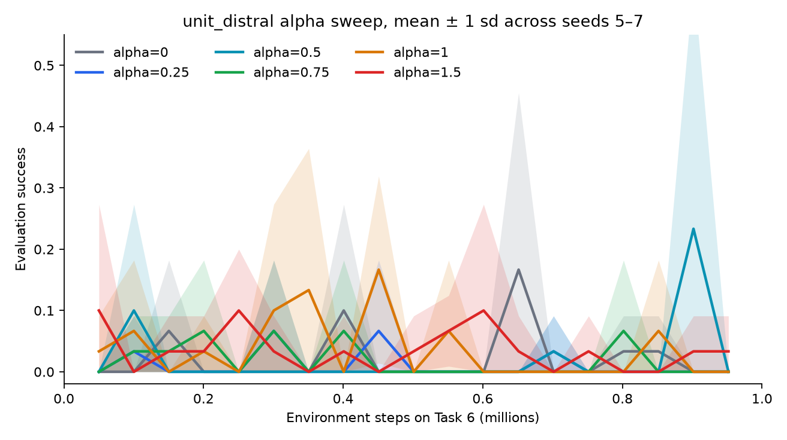
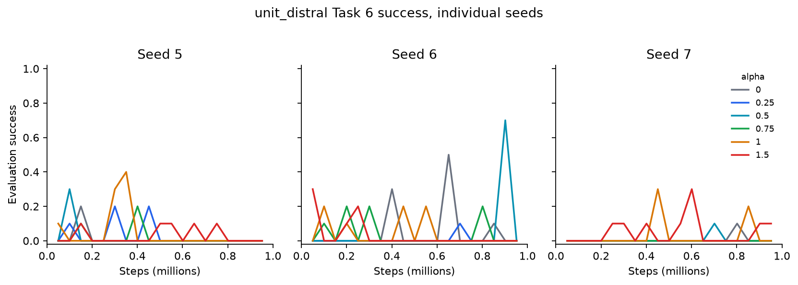
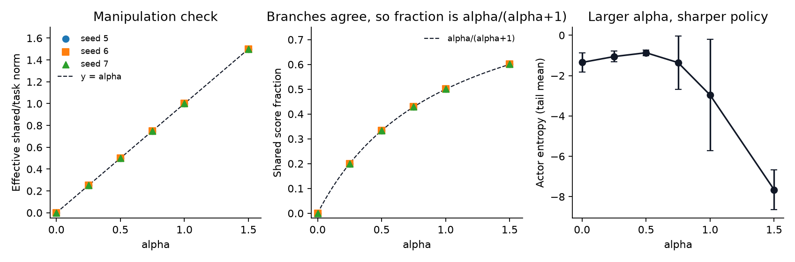
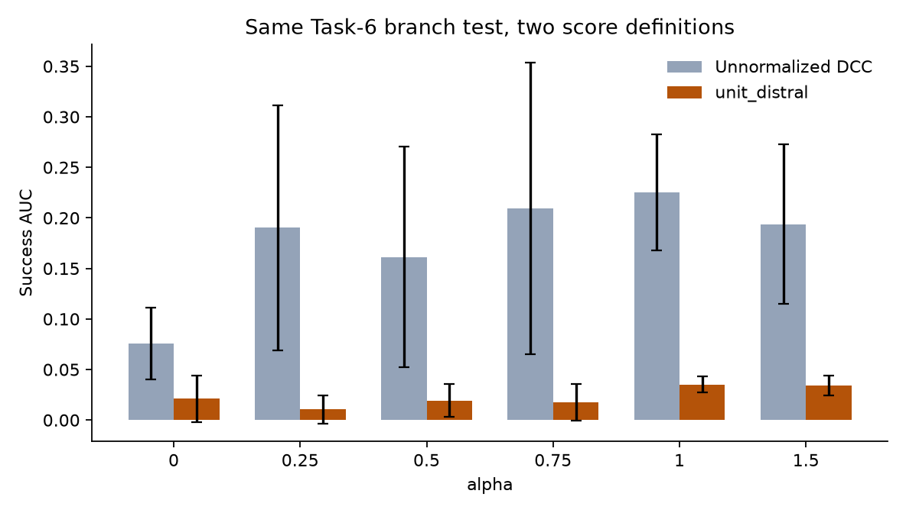

# Distral-faithful unit-normalized alpha results on Task 6

Date: 2026-10-12

## Which experiment this is

The from-scratch seven-task sweep
(`DCC-DISTRAL-UNIT-ALPHA-CONTINUAL7-1M`) has no W&B runs. It was not
launched.

What did finish is the earlier branch test, all 18 runs, in
`nyuad_mmvc/continual-contrastive-rl`, group
`DCC-DISTRAL-UNIT-SHARED-SCALE-TASK5-BRANCH-1M`. Tasks 0–4 were trained
once with ordinary DCC at alpha 1. Each alpha then retrains only code
task 5, `sawyer_handle_press_side` (human Task 6), for one million
steps. Alphas are `0, 0.25, 0.5, 0.75, 1, 1.5`. Seeds are 5, 6, and 7.
The score is `unit_distral`: unit-norm each branch, then
`alpha * shared + task`, with no division by `alpha + 1`.

Evaluations are 10 episodes, logged about every 50k steps. The last
logged evaluation is at 951,900 steps. Success AUC divides the area
under that curve by the last evaluation step. Final-3 is the mean of
the last three evaluations. Mechanism numbers are the mean of the last
10% of learner logs.

## Performance

Mean ± standard deviation across three seeds.

| alpha | Best success | Success AUC | Final-3 success | Success at 952k |
|---:|---:|---:|---:|---:|
| 0 | 0.267 ± 0.208 | 0.021 ± 0.023 | 0.011 ± 0.019 | 0.000 ± 0.000 |
| 0.25 | 0.100 ± 0.100 | 0.011 ± 0.014 | 0.000 ± 0.000 | 0.000 ± 0.000 |
| 0.5 | 0.367 ± 0.306 | 0.019 ± 0.016 | 0.078 ± 0.135 | 0.000 ± 0.000 |
| 0.75 | 0.133 ± 0.116 | 0.018 ± 0.019 | 0.000 ± 0.000 | 0.000 ± 0.000 |
| 1 | 0.300 ± 0.100 | 0.035 ± 0.008 | 0.022 ± 0.038 | 0.000 ± 0.000 |
| 1.5 | 0.233 ± 0.116 | 0.034 ± 0.010 | 0.022 ± 0.038 | 0.033 ± 0.058 |

Success AUC for each seed:

| seed | 0 | 0.25 | 0.5 | 0.75 | 1 | 1.5 |
|---:|---:|---:|---:|---:|---:|---:|
| 5 | 0.011 | 0.026 | 0.016 | 0.016 | 0.042 | 0.026 |
| 6 | 0.047 | 0.005 | 0.037 | 0.037 | 0.037 | 0.032 |
| 7 | 0.005 | 0.000 | 0.005 | 0.000 | 0.026 | 0.045 |

The curves are sparse spikes, not learning curves that rise and stay
up. Only two runs ever reach 50% on any evaluation (alpha 0 seed 6, and
alpha 0.5 seed 6). Neither holds it. Seed 6 at alpha 0.5 is the late
spike in the mean plot; the other two seeds at that alpha stay near
zero.

## Manipulation check

The effective shared-to-task norm ratio equals alpha for every seed, to
the recorded precision. Raw branch norms still move, and they no longer
cancel the forward coefficient. Shared score fraction sits on
`alpha / (alpha + 1)` because the two unit vectors point almost the
same way: their cosine is about 0.998 whenever alpha is positive. At
alpha 0, where the shared branch is removed from the score, that cosine
is about 0.

| alpha | Norm ratio | Shared score fraction | Branch cosine | Raw shared norm | Actor entropy |
|---:|---:|---:|---:|---:|---:|
| 0 | 0.00 | 0.000 | 0.000 | 6.8 ± 0.9 | −1.35 ± 0.49 |
| 0.25 | 0.25 | 0.200 | 0.999 | 26.2 ± 12.4 | −1.06 ± 0.27 |
| 0.5 | 0.50 | 0.334 | 0.999 | 27.7 ± 11.5 | −0.87 ± 0.14 |
| 0.75 | 0.75 | 0.429 | 0.998 | 24.6 ± 7.5 | −1.36 ± 1.33 |
| 1 | 1.00 | 0.500 | 0.998 | 21.8 ± 7.5 | −2.96 ± 2.76 |
| 1.5 | 1.50 | 0.601 | 0.998 | 19.1 ± 7.2 | −7.66 ± 0.98 |

Critic categorical accuracy stays near 0.97 and the dynamics loss stays
near 0 at every alpha. The critic is not collapsing. The actor is:
entropy falls as alpha grows, because `unit_distral` increases the total
score scale and the temperature is unchanged.

## What this says

1. The coefficient does what the algebra says. Alpha sets the forward
   shared-to-task ratio, and the network cannot undo it by shrinking the
   shared branch. That is the opposite of the unnormalized sweep, where
   the raw shared norm fell from about 59 at alpha 0.25 to about 18 at
   alpha 1.5 and the score fraction stayed near one half.

2. Alpha is not acting as a useful Distral prior on this task. Success
   stays near the floor at every alpha. Best success is not ordered.
   Alpha 1 beats alpha 0 on AUC for seeds 5 and 7 and loses for seed 6.
   Among the non-zero alphas, AUC drifts up slightly with alpha
   (Spearman r = 0.58, p = 0.022), by a few hundredths of success, and
   that drift lines up with the entropy collapse. It is a scale effect,
   not evidence that a stronger shared policy prior transfers better.

3. The task branch is not supplying a distinct correction. Once both
   branches are in the score, they align. Alpha then multiplies one
   shared direction instead of mixing a shared policy with a
   task-specific one.

4. Unit normalization itself changes the algorithm, and here it hurts.
   On the same prefix and the same Task-6 branch protocol, unnormalized
   DCC at alpha 1 has success AUC 0.225 ± 0.057. `unit_distral` at
   alpha 1 has 0.035 ± 0.008. The gap is already present at alpha 0
   (0.075 versus 0.021), so it is not only the shared-prior term. Unit
   normalizing the task-goal score changes the score scale the actor
   sees.

## Boundary

This does not test learning alpha into the shared representation from
scratch, and it does not cover tasks other than `sawyer_handle_press_side`.
Three seeds and 10-episode evaluations make a single lucky evaluation
visible; the seed plots are there for that reason. The practical claim
in the handoff is not supported on this task: the norm-ratio check
passes, and the behavior is a low, noisy floor explained in part by
score scale and policy entropy.
